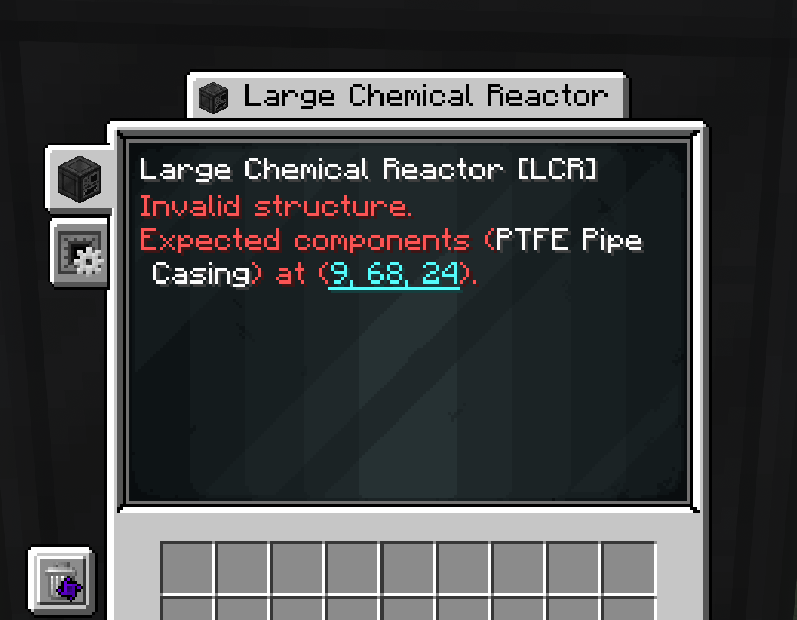
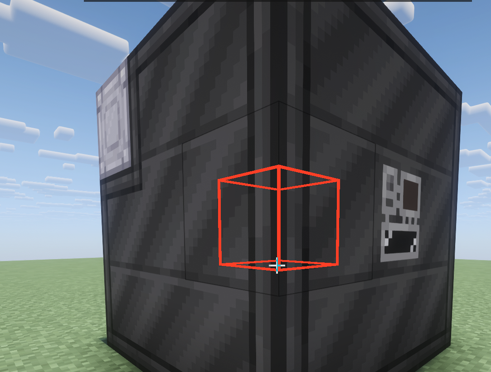
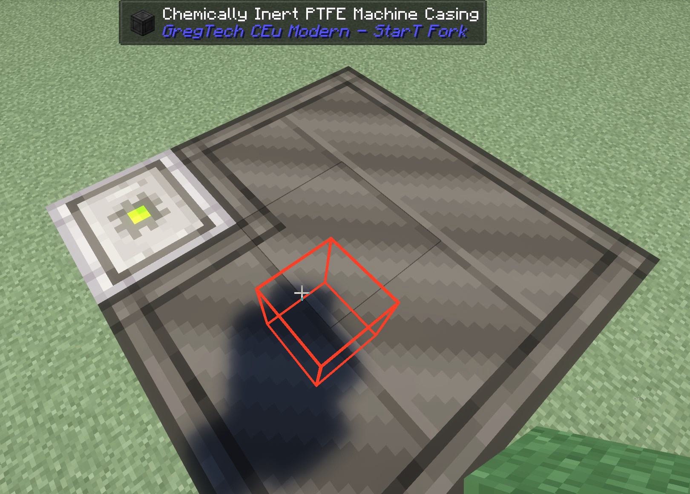
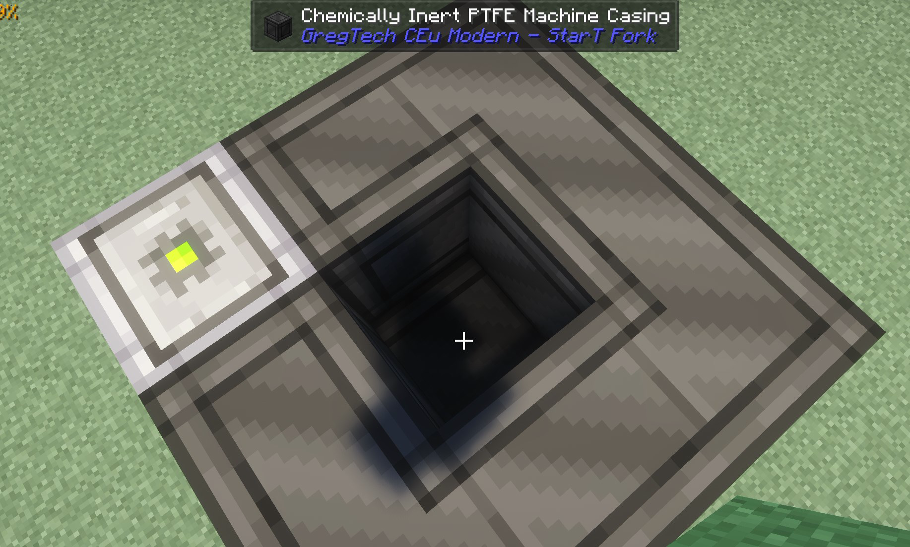

# GregTech Multiblock Locator

A client utility mod built for Star Technology that enables players to find errors with GregTech multiblocks quicker by highlighting problematic blocks.


## How to use

1. Open the multiblock controller. When it reports an issue with coordinates, those coordinates appear as a cyan link.

   

2. Click the coordinates, then close the controller screen.  A red outline marks the reported block position, visible through the multiblock's casing.  
By default the outline will last 5 seconds after closing the GUI.

   
    
    Top view of the reactor showing the block highlighted in the middle.

   

    Looking inside we can see that the block is the wrong type (should be a PTFE Pipe block).

   

After making a repair, check the controller again for any remaining errors and click the updated coordinates if there is a new error.

## Installation

This has been built and is tested on the Star Technology Theta 2 version. Other versions should work, but have not been verified!

1. Download the mod jar file from the releases tab.
1. Make sure Minecraft is closed, and place the jar file in the `mods` directory.

## Configuration

There are multiple ways to configure the mod, the easiest way is via ModConfig in game.

Alternatively, after the first client startup, edit `config/gtmultiblocklocator-client.toml`
and restart the client:

```toml
[highlight]
enabled = true
durationSeconds = 5
```

- `enabled`: enables the coordinate links and outline. Disabling clears existing cues.
- `durationSeconds`: whole seconds from **1 to 300**, measured from GUI close.
  Each click uses the duration configured when the position is selected.

## Coverage and limitations

The addon highlights only the one error that was being reported at a time.
It also doesn't update as you repair blocks, so they can get stale pretty quickly.

## License

[MIT](LICENSE).
